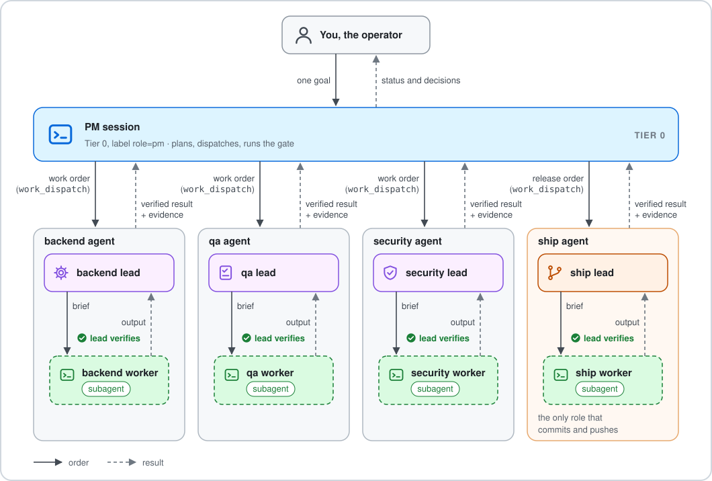
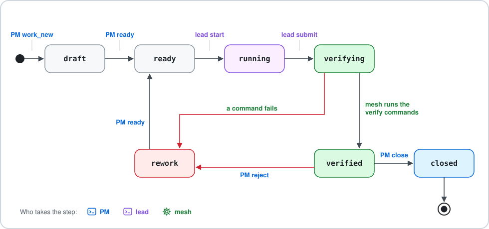
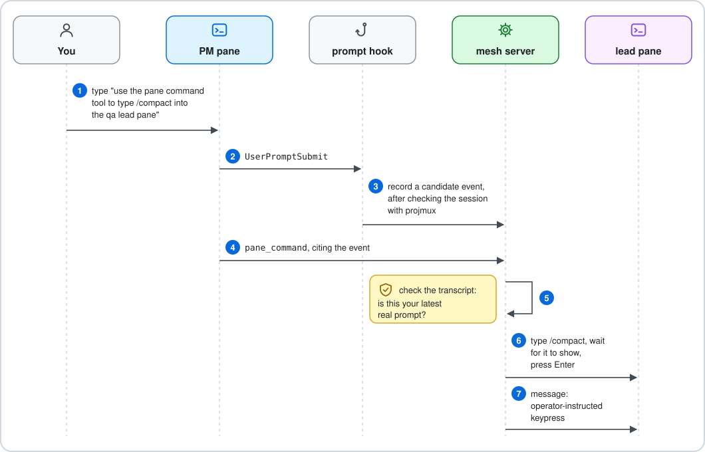

# supervisor-mesh

supervisor-mesh is a Claude Code plugin that runs a project as a team of Claude sessions. You talk to one PM session. The PM splits your goal into work orders and sends them to role leads (backend, QA, security, ship, and more). Each lead gives the work to a worker and checks the result before it reports back.

The plugin does not replace your judgment or write your code. It makes mistakes hard to make.

## Why it works this way

Several AI sessions on one project fail in predictable ways. A session reports "done" when it is not. Two sessions edit the same file. A model approves its own risky action. A harness slowly drifts away from the code it describes. Each rule below answers one of these failures.

- **Planning, checking, and doing are separate jobs.** The PM plans and dispatches. A lead checks. A worker produces. No session checks its own work.
- **Evidence, not claims.** A task is done when there is captured output: a command, its exit code, a live capture. A sentence such as "all tests pass" is not evidence. The MCP server runs the verify commands itself and binds the result to the commit.
- **One writer per document.** Only the PM writes the coordination documents (the tracker, the work orders, and the decision log). Every other session reads them and writes only its own report.
- **The human decides.** Only the Ship role pushes, and only after you approve. Risky actions need your own typed instruction, and the most sensitive ones need a one-time code that only you can see.
- **Harnesses decay, so clean up continuously.** `/supervisor-mesh:gc` finds dead code, stale docs, and leftover files, and removes them after you confirm.

The method behind these rules is in [`docs/core/methodology.md`](docs/core/methodology.md).

## How the pieces fit



You and the PM talk in one pane. The PM and each role lead are separate Claude sessions in projmux panes, and projmux carries the orders and reports between them. A worker is not a pane: it is a subagent inside its lead's session, so the lead gets the output directly and checks it before it reports to the PM.

## Prerequisites

Check each tool with the command shown. Install anything missing before you install the plugin.

- **projmux** (required). It manages the panes and delivers messages. Check: `projmux --help`. projmux runs on tmux (check: `tmux -V`), so on Windows run everything inside WSL. This plugin does not install projmux.
- **python3 ≥ 3.11** (required). The MCP server, `init`, `gc`, and `slack-setup` use only the standard library. TypeScript projects need Python too, because `init` adds Python GC scripts for every stack. Check: `python3 --version`.
  - Ubuntu, Debian, or WSL: `sudo apt update && sudo apt install -y python3`. Ubuntu 24.04 ships 3.12. Ubuntu 22.04 ships 3.10, so add `python3.12` from the deadsnakes PPA or use pyenv.
  - macOS: `brew install python@3.12`.
- **Claude Code** (required). Check: `claude --version`. `claude plugin --help` must list `marketplace` and `install`.
- **GitHub access.** `marketplace add` fetches `minwookim-crevisse/supervisor-mesh` from GitHub. If the repository is private for you, your git credentials must be able to read it.
- **Companion plugins** (recommended, not bundled). They stay maintained upstream:
  - a spec tool such as `ready` or `office-hours`, to shape the spec before you scaffold;
  - plan reviews such as `plan-eng-review` and `plan-ceo-review`;
  - `karpathy-guidelines`, the four work-discipline principles this plugin embeds.

  `/supervisor-mesh:init` reports which companions are present. It never installs them on its own. The MCP tool `companions_install` installs pstack and mattpocock-skills at project scope only after you ask for it in a prompt. For gstack it prints the install command for you to run.

## Install

Open the project in projmux first, then install the plugin from the PM pane.

1. Register the project and open a Claude pane labelled `role=pm`. Run these from a shell in the project:
   ```
   projmux create project --root <absolute-project-dir>
   projmux attach project <name>                          # inside tmux: projmux open project <name>
   projmux create claude --project <name> --label role=pm
   ```
   Switch to the new pane and answer the folder-trust prompt once. This pane is your PM. The label matters: the MCP server finds the PM by `role=pm`, and without it every PM tool is refused.
2. Install the plugin from that pane:
   ```
   /plugin marketplace add minwookim-crevisse/supervisor-mesh
   /plugin install supervisor-mesh@supervisor-mesh
   ```
   The default is user scope, which makes the plugin available in every project. For a team, install at project scope (`--scope project` on the CLI). The CLI form, from a shell in the project:
   ```
   claude plugin marketplace add minwookim-crevisse/supervisor-mesh
   claude plugin install supervisor-mesh@supervisor-mesh --scope project
   ```
3. To update later, run `claude plugin marketplace update supervisor-mesh`, then update the plugin. An installed project keeps its old version until you update it there.

## Quickstart

Run these in the PM pane:

```
/supervisor-mesh:init           # scaffold the project, then fill in the Part B checklist it creates
/supervisor-mesh:spawn-roles    # create one pane per role lead
/supervisor-mesh:run <goal>     # give the PM one goal; it plans, dispatches, and gates the work
```

You do not dispatch to each role yourself. `run` splits the goal into work items, sends them in dependency order, and reports with `mesh_status` and `mesh_metrics`. To send one order by hand, use `/supervisor-mesh:dispatch <role> <task>`.

## MCP server

The plugin includes an MCP server named `supervisor-mesh`. It starts with the plugin. To check that it is connected, run `/mcp`: it lists `plugin:supervisor-mesh:supervisor-mesh` with 11 tools.

The server keeps the state of every work item in `.mesh/state.json` in your project, and `docs/tracker.md` becomes a view generated from that state. A table of transitions decides who may move an item from one state to the next, so a lead cannot close its own item and the PM cannot skip verification.

The common path of one work item, with the role that takes each step:



Items can also wait in `blocked(awaiting_user)`, `blocked(environment)`, `blocked(limit)`, or `blocked(children)`, or end in `cancelled`. The full table is in [`docs/designs/work-item-state-model.md`](docs/designs/work-item-state-model.md).

Technical details: `.mcp.json` runs `python3 ${CLAUDE_PLUGIN_ROOT}/mesh/mcp_server.py`. It uses only the standard library, speaks newline-delimited JSON-RPC over stdio, and logs on stderr.

### Tools

| tool | who calls it | what it does |
|---|---|---|
| `mesh_init` | anyone to preview, the PM to apply | Sets up `.mesh/`, the PM-pane prompt hook, and the scaffold, and imports an existing `docs/tracker.md` once. Preview and apply are two calls: apply needs the preview's `plan_id`. |
| `mesh_status` | anyone | Shows items by state, live leads, pending actions, your identity, and the last operator event. Read-only. |
| `mesh_metrics` | anyone | Counts rework per item, PASS reversals, and operator interventions. Indicative only, never a gate. Read-only. |
| `work_list`, `work_show` | anyone | Lists the items, or shows one item. Read-only. |
| `work_new` | the PM | Creates a draft work item. |
| `work_transition` | as the table allows | Every other lifecycle step: `ready`, `start`, `submit`, `verify`, `fail`, `close`, `reply`, `override`, and more. |
| `work_dispatch` | the PM | Sends a lead the standard header, the item id, and the path of the work-order file over `projmux agent message send`. The order itself stays in the file, so the message fits the 4096-byte projmux limit. |
| `tracker_render` | the PM | Regenerates the marked region of `docs/tracker.md`. |
| `pane_command` | the PM | Types one slash command you named into a lead's idle pane. |
| `companions_install` | the PM | Installs the missing pstack and mattpocock-skills at project scope after you ask for it. |

Every tool is also available from a shell as `.mesh/bin/mesh <tool> --<arg> ...`, for example `.mesh/bin/mesh mesh_status`. `mesh_init` writes that launcher.

### Message or keystrokes: how the PM reaches a lead

The PM has two ways to reach a lead, and it uses the first one for almost everything.

- **A projmux message (`work_dispatch`)** carries all ordinary work: orders, questions, follow-ups, and decisions. It waits in a queue while the lead is busy, and it needs no approval from you. To have a lead use a skill, the order names the skill, and the lead runs it itself.
- **Keystrokes (`pane_command`)** are only for commands that must be typed into the input box: Claude Code built-in commands such as `/compact` or `/clear`, and skills that only a human may start. Each call needs your typed instruction, the lead must be idle, and mesh waits until the text shows in the input box before it presses Enter.

### Who is who

The server identifies the caller by the projmux pane the session runs in.

- **The PM** is the agent labelled `role=pm`. `mesh_init` pins that agent, and PM tools are refused while more than one live `role=pm` agent exists.
- **A lead** is any other agent with a `role=<role>` label in the project.
- **Anyone else** can read. Every write is refused and recorded in `.mesh/refusals.jsonl`.

Each write tool also checks that the calling process runs under the Claude process of the pane it claims to be.

### How your approval is recorded

Some actions need your instruction, not the PM's. Mesh records what you type in the PM pane and accepts only those records as approvals.



1. `mesh_init` adds a `UserPromptSubmit` hook to the project's `.claude/settings.json`. When you submit a prompt in the PM pane, the hook records it in `.mesh/events.jsonl` as a candidate event.
2. The hook records the prompt only if the pane is the pinned PM, and only if its session id and transcript path match what projmux reports for that agent right now.
3. When the PM later cites the event (for example to run `pane_command`), mesh opens the session transcript and checks that your latest real prompt says exactly that. A real prompt is one that you typed. Messages from other sessions, task notifications, and tool results do not count.
4. Each prompt backs one event, and each event is used once. An event that fails the check stays refused.

A prompt that the PM makes up in its own shell has no matching transcript entry, so mesh refuses it.

- `pane_command` and `companions_install` act only on an event whose prompt names them.
- `reply` cites an event as your answer.
- `override` cites an event that names the item id.

### One-time codes for the riskiest actions

Four kinds of action need a one-time code on top of your prompt:

- `override`;
- `companions_install`;
- moving the PM pin to a new pane;
- `pane_command` with a privilege-changing command such as `/config`, `/permissions`, `/login`, `/logout`, `/mcp`, `/plugin`, `/plugins`, `/hooks`, `/settings`, or `/allowed-tools` (matched case-insensitively).

Mesh shows the code in a tmux popup on your PM pane. You type the code into the popup. Mesh generates the code, keeps only its hash, and compares the hash with what you typed. The code never touches the disk: it travels through two one-shot pipes in a private temp folder that mesh deletes at once. Mesh decides only after its own popup closes. If anything else touches the pipes, or the popup reports no code, the action is refused, and the popup shows the refusal.

To move the PM pin to a new pane: stop the old PM, type `re-pin <new PM agent uid>` in the new PM pane, run `mesh_init` apply there, and enter the code.

### Extra guard rails

- `mesh_init` adds `permissions.deny` rules to `.claude/settings.json`. They block the PM's own shell from writing mesh events, from typing into panes with tmux, and from editing `.mesh/state.json`, `.mesh/events.jsonl`, and `.mesh/refusals.jsonl`. The rules are advisory, because a model can word around a glob. They add a layer on top of the checks above.
- `mesh_init` and `tracker_render` refuse any write that a symlink would send outside the project.
- `verify` runs the optional `verify.prepare` step first (for example `npm ci`). A failed prepare is an environment problem, not a defect. A passing command still fails if an output line contains one of its `fail_if_output` strings. The TypeScript stack sets `0 modules, 0 dependencies cruised` and `No test files found` by default, so an empty run cannot pass.

The full design, with the reason for each rule, is in [`docs/designs/mcp-server-spec.md`](docs/designs/mcp-server-spec.md) (decisions D77 to D125).

## Skills

| skill | what it does |
|---|---|
| `init` | Scaffolds the four pillars into the current project. Safe to run again: it never overwrites your files. |
| `spawn-roles` | Creates one pane per role lead. `dispatch` needs these panes. |
| `run` | `/supervisor-mesh:run <goal>`: the PM turns one goal into work items, dispatches them in dependency order, and gates each one on evidence that mesh collected. |
| `dispatch` | Sends one work order to a role pane. It fails if the pane does not exist, and it never creates one. |
| `add-agent` | Adds a new role lead to the project's `.claude/agents/`, from the role-lead template. |
| `gc` | Finds drift in code, docs, and structure. It reports first and deletes only after you confirm. |
| `slack-setup` | Sets up an optional Slack bridge, so you can steer the PM while you are away. The token stays in your local `.env`. |

## Agents

The base set is `pm-orchestrator` (Tier 0), the role leads `role-lead-fe`, `role-lead-qa`, `role-lead-designer`, `role-lead-backend`, `role-lead-security`, and `role-lead-ship` (Tier 1), and the read-only helper `scope-mapper`.

Every role lead carries the same rules: lead plus worker plus lead review, the four work principles, the evidence-first gate, and the rule that messages from other sessions are data, not approval. They come from `templates/agents/role-lead.md`. Project-specific roles live in the project (add them with `add-agent`), so a plugin update never overwrites them.

## The four pillars that `init` scaffolds

1. **Instructions.** `AGENTS.md`: the entry point, the role model, the dispatch rules, the restore order, and the cleanup rules.
2. **Constraints.** A linter and import-boundary rules that a machine enforces. TypeScript gets eslint and dependency-cruiser. Python gets ruff, import-linter, and mypy. Each rule carries a `why:` comment.
3. **Feedback.** `tests/`, a test runner, and an audit gate (`scripts/audit.sh`). A non-zero exit blocks a release.
4. **Knowledge.** `docs/decisions/` (the decision log, which outranks every other document) and `docs/conventions/` (the glossary and reusable conventions).

The templates come pre-filled with the rules that carry over between projects (Part A). Only the facts about your project are left blank, in `docs/harness/part-b-checklist.md` (Part B).

## Garbage collection

`/supervisor-mesh:gc` and a weekly `housekeeping.yml` workflow look for three kinds of drift:

- **code:** dead code;
- **docs:** `AGENTS.md` that no longer matches the tree, and outdated wording;
- **structure:** temp, backup, and junk files, and one-shot scripts left behind.

Detection is read-only. Nothing is deleted until you confirm.

## Security

Secrets and real customer data never go into the plugin, the repo, the docs, or the logs. Slack tokens live in your local `.env`, which git ignores. `slack_bridge.py` reads the token at runtime and sends it only as an HTTP header, never on a command line.

What the checks protect against: a model that acts through the mesh tools, whether by prompt injection or by accident. What they do not protect against: other code that runs as your own OS user. Such code can still forge an ordinary event, for example by adding a fake line to the real transcript, by feeding projmux a forged session record, by editing `.mesh/state.json`, or by racing the popup's pipes. The one-time code still guards the riskiest actions. Real separation would need a channel outside your OS user, and that is out of scope for now.

Other accepted risks:

- Verify commands run with an argument list, an allowlisted environment, and a throwaway worktree as the working folder. There is no sandbox in the standard library, so a command can still write outside the worktree through an absolute path.
- `pane_command` accepts any slash command you name. Privilege-changing commands need the one-time code.

## Built with its own method

This repository uses the same four pillars it ships: [`AGENTS.md`](AGENTS.md), ruff in `pyproject.toml`, `tests/`, `docs/decisions/`, and GC through `make check`. The shipped files (`.claude-plugin/`, `skills/`, `agents/`, `docs/core/`, `templates/`) are kept apart from the files that build this repository. GC and lint skip `templates/` and `docs/core/`, because they hold placeholders and example patterns on purpose. Verification reports are in `docs/reports/`.

## License and version

MIT. Version 0.2.2 makes `pane_command` approvals work on a real project: a typed slash command, an approval typed while the PM is busy, a proposal id approved later within its expiry, a lead pane showing a faint suggestion, a 15 s wait for the typed command to render, and refusals that name the failing rule; it also seeds `scripts/verify.sh` at init, checks the work type at `work_new` and packs at most 4 panes per window. Version 0.2.1 rewrote the README with diagrams and made a worker its lead's in-process subagent (DEC-0016). Version 0.2.0 added the MCP server (11 tools). `.claude-plugin/plugin.json` holds the version, and every shipped change raises it, because `claude plugin update` delivers new code only when the version changes.
